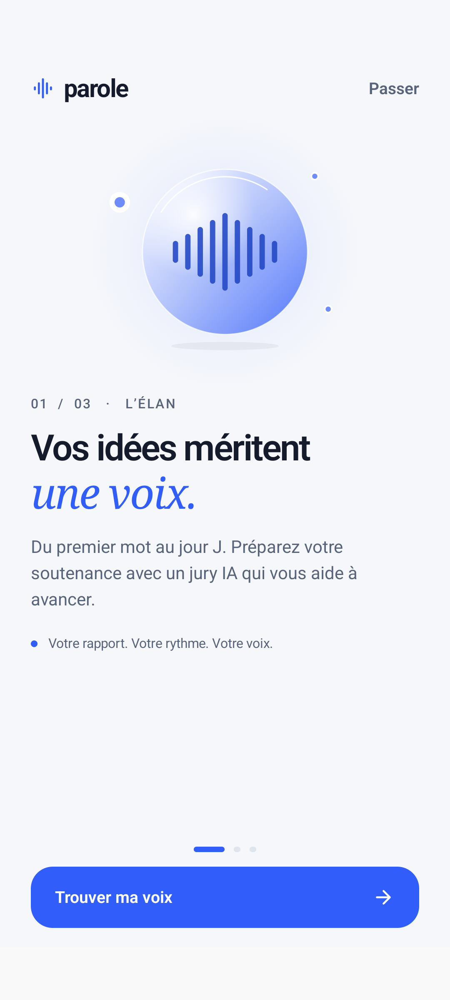
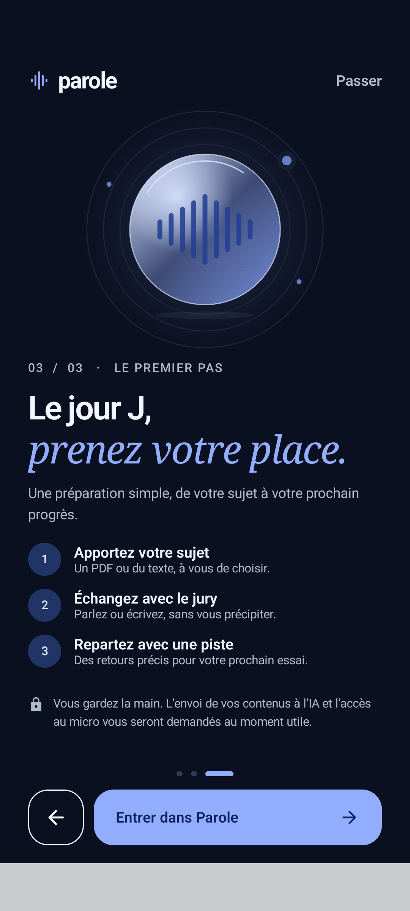
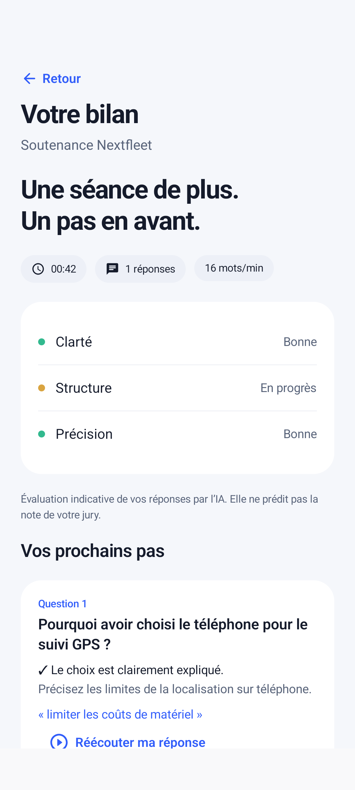

# Parole

[](https://github.com/rito27959-arch/Parole-/actions/workflows/android.yml)

Application Android native **Kotlin + Jetpack Compose**, avec jury Groq, authentification et persistance Firebase, et publicités récompensées AdMob. Thèmes clair, sombre et système.

> **Bêta 1.1.0** : interface installable et tests CI disponibles. Firebase Auth est activé ; Firestore et la liaison privilégiée du serveur restent à finaliser. Les séances IA en production ne sont donc pas encore disponibles. AdMob utilise des annonces de test.

## Parcours implémenté

- Splash natif animé, sans délai artificiel ; adaptation claire/sombre et réduction des animations.
- Onboarding en trois étapes, utilisable hors ligne : niveau et jury mémorisés, retour, passage et reprise depuis le profil.
- Inscription/connexion e-mail, réinitialisation du mot de passe.
- Import PDF textuel (80 pages, 10 Mo) ou texte collé (100 000 caractères).
- Préparation BTS/Licence/Master, jury bienveillant/exigeant.
- Enregistrement AAC, pause/reprise, permissions microphone, mise en pause en arrière-plan.
- Transcription Groq Whisper, correction manuelle avant envoi, réponses écrites.
- Questions contextuelles et retours Groq, citations de pages validées.
- Historique persistant Firestore, cache privé par utilisateur, brouillons locaux et reprise.
- Bilan, réécoute locale, partage de texte, suppression des projets et du compte.
- UMP, annonces de test en bêta, vérification SSV des récompenses en production.

**Les données de démonstration sont uniquement dans les tests Android. L’application n’invente ni séance, ni score, ni réponse IA.** Sans configuration du cloud, l’interface affiche explicitement le service à activer.

## Construire

JDK 17, SDK Android 36, Gradle 8.13 :

```sh
./gradlew :app:assembleDebug :app:testDebugUnitTest :app:lintDebug
```

APK : `app/build/outputs/apk/debug/app-debug.apk` (signature de développement, annonces Google de test).

GitHub Actions `Parole · Build et tests` exécute les tests serveur, lint/unitaires Android, construit l’APK, puis lance un émulateur pour les tests Compose et les captures en clair, sombre et grandes polices.

## Activer Firebase et le serveur

Voir [docs/DEPLOYMENT.md](docs/DEPLOYMENT.md). L’API n’autorise aucune séance sans Firebase valide et une clé Groq configurée.

Le projet n’embarque **aucune clé Groq**, aucun compte de service ni clé de signature. Les identifiants AdMob utilisés par défaut sont les identifiants de test Google.

Deux méthodes pour configurer Firebase Android :

1. `app/google-services.json` fourni au build (ignoré par Git), avec clients `app.parole` et `app.parole.debug` ;
2. configuration Android publique fournie par votre backend `/config`, chargée au démarrage. Cela permet l’activation Firebase sans reconstruire l’APK.

## Tests

```sh
cd server
npm ci
npm test
```

La suite API teste les permissions, l’isolation des comptes, les limites, les doublons, la concurrence, les erreurs Groq et les signatures SSV. Ces tests utilisent un fournisseur IA simulé **uniquement dans les tests**, et ne prouvent pas à eux seuls une connexion réelle à Groq/Firebase.

## Limites explicites de cette version

- PDF scannés : message d’erreur explicite et saisie texte alternative ; OCR non intégré.
- Le jury vocal fonctionne par tours, pas en conversation audio simultanée.
- Les audios restent sur l’appareil ; la synchronisation cloud porte sur le texte et les bilans.
- Pas d’abonnement ni de paiement intégré dans cette version.
- Les annonces de production exigent les vrais identifiants AdMob, UMP et la configuration SSV.
- La mise en production exige des secrets Firebase, une clé Groq valide et une signature Android privée.

## Vérifications d’intégration Firebase

Les émulateurs officiels testent Firebase Auth, la persistance Firestore, les transactions, les règles d’accès et la suppression du compte. Aucun compte réel ni secret n’est utilisé :

```sh
npm ci --prefix server
npm ci --prefix qa --ignore-scripts
qa/node_modules/.bin/firebase emulators:exec --only auth,firestore --project demo-parole-ci 'node --test server/integration/firebase.test.js'
```

JDK 21 est nécessaire pour les émulateurs Firebase. Le build Android utilise JDK 17. Les outils de `qa/` restent réservés aux tests et ne sont pas inclus dans le serveur déployé.

## Captures de l’interface native

Captures produites par les tests Android sur émulateur. Les projets et bilans visibles ici sont des données fictives de test. L’application livrée démarre sans historique prérempli.

| Onboarding clair | Onboarding sombre |
| --- | --- |
|  |  |

| Choix du jury clair | Choix du jury sombre |
| --- | --- |
|  |  |

| Accueil clair | Accueil sombre |
| --- | --- |
|  |  |

| Séance vocale | Bilan |
| --- | --- |
|  |  |

[Bilan des vérifications et limites de la bêta](docs/VALIDATION.md).
